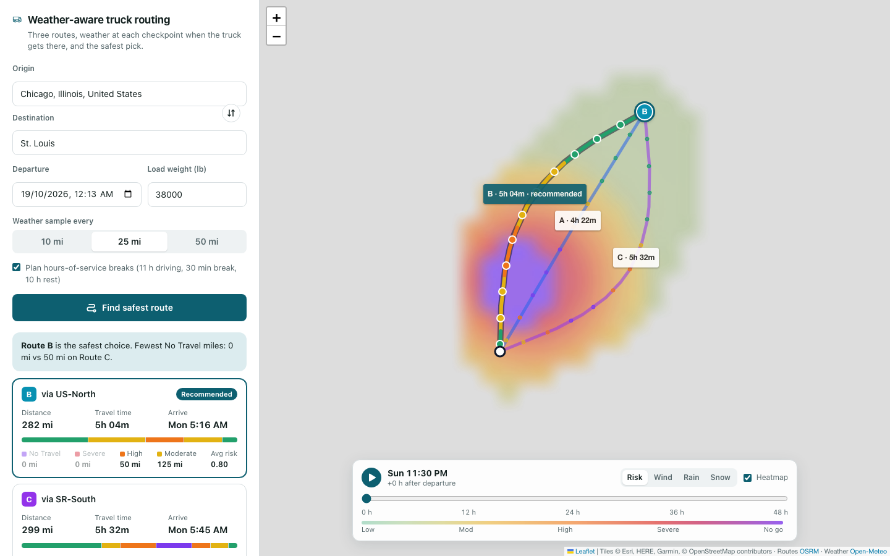

# Weather-Aware Truck Routing

**Live: https://spotter-truck-routing-seven.vercel.app**

React + Django app that helps a truck driver pick the safest route. It weighs weather at the moment the
truck reaches each checkpoint, the load weight and the travel time.

Enter an origin, a destination, a departure time and the load. The app:

1. Fetches **3 route options** from OSRM. If the router returns fewer, it forces detours through via-points.
2. Places **checkpoints every 10, 25 or 50 miles** (your choice) and works out the truck's **ETA at each one**.
3. Looks up the forecast **for that hour at that place** and classifies it with the **risk and load rules**.
4. **Recommends a route** by fewest Severe miles, then High miles, then average risk, then travel time.
5. Shows everything on a map: the 3 routes, colour-coded checkpoints with ETAs and weather, route summaries,
   HOS stops, and a **corridor weather heatmap with a 0-48 h forecast slider**. The trucks move along their
   routes as you scrub.



## Quick start

```bash
# backend (Python 3.12+)
python3 -m venv .venv && .venv/bin/pip install -r backend/requirements-dev.txt
cd backend && DJANGO_DEBUG=1 ../.venv/bin/python manage.py runserver        # live APIs
# or: DJANGO_DEBUG=1 PROVIDERS=fake ../.venv/bin/python manage.py runserver # offline storm demo

# frontend (Node 20+), in another shell
cd frontend && npm install && npm run dev   # http://localhost:5173, proxies /api to :8000
```

No API keys are needed. Routing uses the public OSRM server, weather uses Open-Meteo and geocoding uses Photon.

`PROVIDERS=fake` swaps all three for deterministic stand-ins: three bowed routes, plus a storm cell drifting
east across central Illinois. Try **Chicago to St. Louis** to watch the recommendation pick the detour around
the storm.

## Tests

| Suite | Command | What it covers |
| --- | --- | --- |
| Backend unit + API (105) | `cd backend && ../.venv/bin/pytest` | every risk/load threshold edge, polyline codec, HOS maths, ETA weather lookup, ranking order, forced alternatives, API validation/errors/rate limit, provider parsing with mocked HTTP |
| Frontend unit (17) | `cd frontend && npm test` | polyline decoding, colour ramps, heatmap pixels, truck interpolation, form payload, route list, API errors |
| End-to-end (22) | `cd frontend && npm run test:e2e` | production build served by gunicorn, on desktop and mobile: plan, select, slider, play, layers, HOS stops, suggestions, validation, upstream errors, light/dark + reduced motion, heatmap outage, no console errors |

Lint: `ruff check . && ruff format --check .` (backend) and `npm run lint` (frontend). CI runs all of it on every push.

## How it works

```
React (Vite, Leaflet)  ──POST /api/plan──▶  Django + DRF
                                            ├─ OSRM          3 routes + per-segment durations
                                            ├─ Open-Meteo    hourly wind / rain / snow (one batched call)
                                            └─ Photon        geocoding (GET /api/geocode for suggestions)
```

`backend/trips/` holds the whole domain. Each file does one job:

| File | Responsibility |
| --- | --- |
| `risk.py` | Risk table + load rules → level (and a continuous index for the heatmap) |
| `planner.py` | routes → truck ETAs (speed cap + HOS) → checkpoints → weather → summaries → recommendation |
| `heatmap.py` | Web-Mercator grid of cells inside a 35 mi corridor, hourly frames for 0-48 h |
| `providers.py` | OSRM / Open-Meteo / Photon clients with caching, plus the `Fake*` twins |
| `geo.py` | haversine, polyline codec, milepost interpolation |
| `views.py` | DRF endpoints, validation, error mapping (400 / 422 / 429 / 502) |

### Risk rules

| Condition | Low | Moderate | High | Severe | No Travel |
| --- | --- | --- | --- | --- | --- |
| Wind (mph) | < 25 | 25-34 | 35-44 | 45-54 | ≥ 55 |
| Rain (in/hr) | < 0.10 | 0.10-0.25 | 0.25-0.50 | 0.50-1.00 | > 1.00 |
| Snow (in/hr) | < 0.5 | 0.5-1.0 | 1.0-2.0 | 2.0-3.0 | > 3.0 |

Load rules: ≥ 55 mph is No Travel for any load. 45-54 mph with a load over 30,000 lb is No Travel. 35-44 mph
with a load over 40,000 lb is Severe. A checkpoint takes the worst of wind (after the load rules), rain and snow.

Where two bands share an edge (0.25, 0.50 in/hr), the value starts the worse band. A value of exactly 1.00 in/hr
of rain, or 3.0 in/hr of snow, is still Severe, because No Travel is written as strictly greater than.

### Decisions and assumptions

- **Weather at the ETA, not at departure.** Each checkpoint uses the forecast for the hour the truck gets
  there. Wind is interpolated between hours. Precipitation is an hourly total, so the code uses the hour the
  truck is driving through.
- **Units are explicit.** Wind is requested in mph. Rain plus showers come back in mm and snowfall in cm,
  and both are converted to inches. Tests pin the conversions.
- **Truck ETAs.** Public OSRM only offers a car profile, so each road segment is capped at 65 mph
  (`TRUCK_MAX_MPH`).
- **Hours of service, on by default.** ETAs follow FMCSA limits: 11 h of driving, a 30-minute break after
  8 h, then 10 h off duty. Without this, the forecast on any trip over about 8 h is checked at the wrong time.
  A checkbox turns it off.
- **Risk miles.** Each checkpoint stands for the road halfway to its neighbours, so the miles in each level add
  up to the route length. Average risk weights each checkpoint's level by the miles it covers.
- **Recommendation order.** No Travel miles come first; the brief doesn't list them, but crossing a No Travel
  zone is worse than any Severe mile. Then Severe miles, High miles, average risk and travel time, in that order.
  Values are rounded (whole miles, two decimals, whole minutes) so noise never decides a tie. The UI says which
  criterion decided and warns when even the best route is Severe or No Travel.
- **Three routes, every time.** OSRM often returns one or two alternatives. The rest are forced through
  via-points offset to either side of the trip. A detour is kept only if it is distinct (under 85% overlap)
  and at most 60% slower than the fastest route.
- **Heatmap smoothness.** Cells sit on a Web-Mercator grid, so the browser paints each hour into a tiny
  image, upsamples it with smoothing and lays it over the map as one image. Scrubbing swaps one cached
  image, so the map never redraws hundreds of shapes. Route layers are memoised and never re-render while you
  scrub.
- **API budget.** Open-Meteo's free tier allows about 600 locations per minute per IP. Each search spends at
  most about 150: up to 90 for checkpoints and 60 heatmap cells. On long trips at 10 mi spacing, nearby
  checkpoints share the nearest forecast grid point; the grid is coarsened only as far as the budget needs,
  about 0.1-0.25°, close to the resolution of the forecast models. Each checkpoint still gets its own ETA hour.
  Points go 100 per request and results are cached for 30 minutes.
- **Graceful degradation.** Checkpoint weather is fetched first. If the heatmap call is rate-limited, the
  routes and recommendation still come back, with a notice that the heatmap is unavailable. Set
  `OPEN_METEO_API_KEY` to raise both budgets.

## API

`POST /api/plan`

```json
{
  "origin": "Chicago, IL",
  "destination": {"label": "Denver", "lat": 39.74, "lon": -104.99},
  "departure": "2026-10-19T14:00:00Z",
  "load_lb": 42000,
  "interval_mi": 25,
  "hos": true
}
```

Places can be free text, `"lat,lon"` or `{label, lat, lon}`. The departure must fall between 1 hour ago and
7 days ahead, and `interval_mi` must be 10, 25 or 50.

The response has `routes[]`, each with summary, checkpoints, coloured spans, HOS stops and a timed track, plus
`recommendation` and `heatmap`.

`GET /api/geocode?q=` returns place suggestions. `GET /api/health` is the health check.

## Deploy

**Live on Vercel** (free Hobby plan): the React build is served from the CDN and Django runs as a Python
function for `/api/*` (`vercel.json`, `api/index.py`). To redeploy:

```bash
npx vercel deploy --prod   # needs DJANGO_SECRET_KEY and DJANGO_ALLOWED_HOSTS=.vercel.app set on the project
```

The same code also ships as one Docker image, where Django/WhiteNoise serves the React build next to the API:

- **Render:** New → Blueprint → select this repo (`render.yaml`).
- **Hugging Face Spaces:** `HF_TOKEN=... scripts/deploy-hf.sh` (Docker Spaces need a PRO account).
- **Anywhere with Docker:**
  `docker build -t truck-routing . && docker run -p 8000:8000 -e DJANGO_SECRET_KEY=... -e DJANGO_ALLOWED_HOSTS=your.host truck-routing`

All settings are environment variables; see `.env.example`.

## Not built (on purpose)

The brief asks for correctness and clarity over extras, so these are left out:

- A truck-specific routing engine. Bridge heights and hazmat restrictions would need OpenRouteService HGV or
  Valhalla truck costing; swapping the router is one class in `providers.py`.
- The 70-hour/8-day HOS cycle.
- Gust-based rules.
- Departure-time optimisation.
